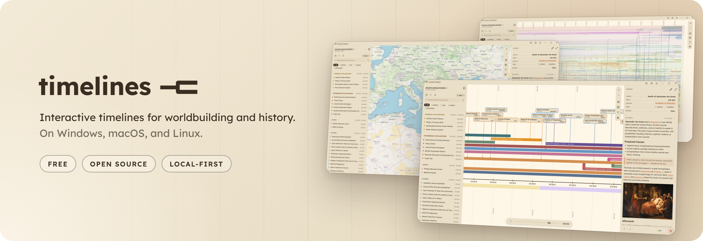
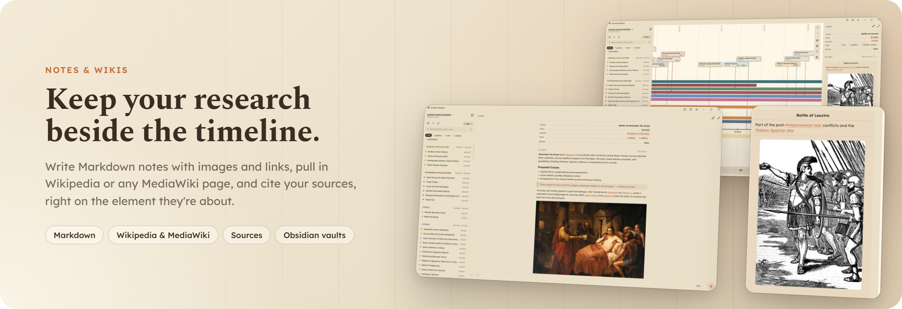
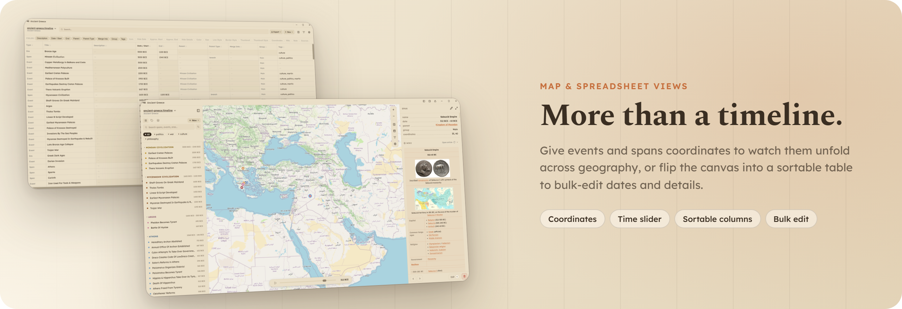
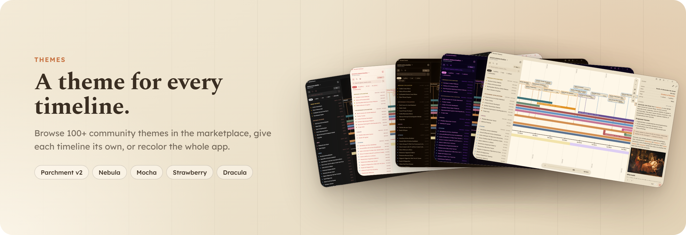
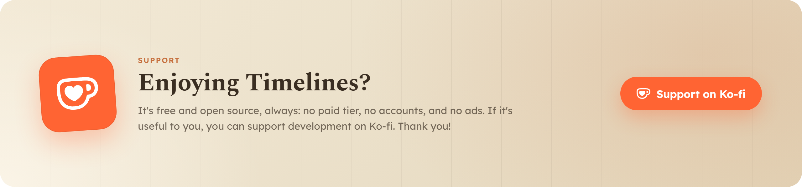

<div align="center">



</div>

---

<div align="center">


### Timelines Studio

Visualize your Notes.

<br/>

<p>
  
  
  <a href="https://www.gnu.org/licenses/gpl-3.0"></a>
  
  
</p>

<br/>

**Download the [latest release](https://github.com/sreegjl/timelines/releases/latest)** for Windows, macOS, and Linux.

<br/>

<sub>
  <a href="https://www.timelines.studio/">Website</a> ·
  <a href="https://www.timelines.studio/gallery">Gallery</a> ·
  <a href="https://www.timelines.studio/wiki">Wiki</a> ·
  <a href="https://www.timelines.studio/viewer">Web Viewer</a> ·
  <a href="https://github.com/sreegjl/timelines/issues/8">Roadmap</a> ·
  <a href="#support">Support</a>
</sub>

</div>

---

## Overview

Timelines Studio is a free, open-source app for creating customizable, interactive timelines for worldbuilding and history. Organize events, spans, and eras with tags and groups, link Markdown notes or MediaWiki sources directly to elements, and visualize timelines geographically with map view and coordinate support.

**Local-first.** Everything lives on your device as plain `.timeline` (JSON) and `.md` files: no account, no cloud, no lock-in.

---

## Features



<table>
<tr>
<td width="50%" valign="top">

### Events, spans & eras

- **Events** pin dated moments, with thumbnail images and icons
- **Spans** draw periods that can branch from or merge into other spans
- **Eras** wrap stretches of time into named bands across the whole canvas
- **Tags & groups** organize elements and filter the canvas to what you're working on

</td>
<td width="50%" valign="top">

### Notes & sources

- Attach **Markdown notes** with images, links, and formatting to any element
- Pull in **Wikipedia or any MediaWiki** page, right in the side panel
- Keep **sources** with the element they back up
- Connect the notes folder to an existing vault, like **Obsidian**

</td>
</tr>
</table>



<table>
<tr>
<td width="50%" valign="top">

### Map view

- Give any event or span **coordinates**
- Scrub the **time slider** and watch places appear and fade as the years pass
- Click a place to open its notes and wiki article

</td>
<td width="50%" valign="top">

### Spreadsheet view

- Flip the whole canvas into a **sortable table**
- Edit dates and rename entries inline
- **Bulk-fix** details across many elements at once

</td>
</tr>
</table>



<table>
<tr>
<td width="50%" valign="top">

### Themes

- Browse a [marketplace](https://github.com/sreegjl/timelines-marketplace) of **100+ community themes**
- Set a **different theme per timeline**, or **recolor the entire app**
- Or **upload your own** theme file

</td>
<td width="50%" valign="top">

### Sync & publish

- **Git Sync** to a GitHub repo you own: the same library on every computer, with version history *(experimental)*
- **Publish** any synced timeline as a link that opens in the [web viewer](https://www.timelines.studio/viewer), no install needed
- **Local-first:** your files stay on your device and go nowhere but the repo you choose

</td>
</tr>
</table>

---

## Translations

The interface is translatable. Locale files live in `src/locales/<code>/` as plain JSON, and a language picker sits in App Settings under General, with English as the fallback. See [CONTRIBUTING-i18n.md](CONTRIBUTING-i18n.md) to add a language.

## Installing

Download the installer for your platform from the [Releases page](https://github.com/sreegjl/timelines/releases).

> [!IMPORTANT]
> Timelines isn't notarized by Apple yet, so on first launch macOS may say **"Timelines is damaged and can't be opened."** The download isn't actually damaged, and you only need to do this once.
>
> Open the `.dmg`, drag **Timelines** into your **Applications** folder, then open **Terminal** and run:
>
> ```bash
> xattr -cr /Applications/Timelines.app
> ```
>
> Then launch Timelines from Applications as usual. The command clears the quarantine flag macOS adds to downloaded files. Prefer not to? You can [build from source](#development) instead.
>
> Signing and notarizing the Mac app needs a $99/year Apple Developer license. [Funding it on Ko-fi](https://ko-fi.com/sreegjl/goal?g=30) removes this warning for good and unlocks automatic in-app updates. Progress is tracked in [issue #57](https://github.com/sreegjl/timelines/issues/57).

## Data

Timelines are stored as `.timeline` JSON files and notes as `.md` files. By default these live in your system app data folder. You can point to a custom directory in app settings.

---

## Development

**Prerequisites:** [Node.js LTS](https://nodejs.org/)

**1. Clone the repo**
```bash
git clone https://github.com/sreegjl/timelines.git

cd timelines
```

**2. Install dependencies**
```bash
npm install
```

**3. Start the app**
```bash
npm run electron:dev
```

> [!NOTE]
> App performance is worse in dev mode. Use it to test changes, and build the app for regular use.

**Build the Electron app installer:**
```bash
npm run electron:build
```

The output installer will be in the `release/` folder.

---

## Support

<a href="https://ko-fi.com/sreegjl"></a>
